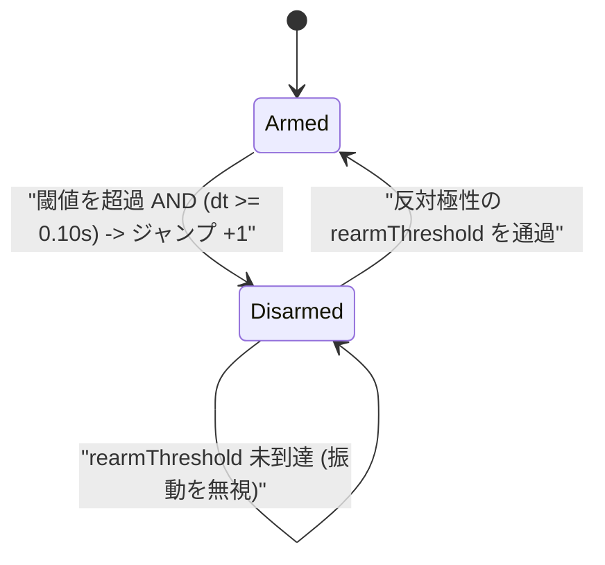
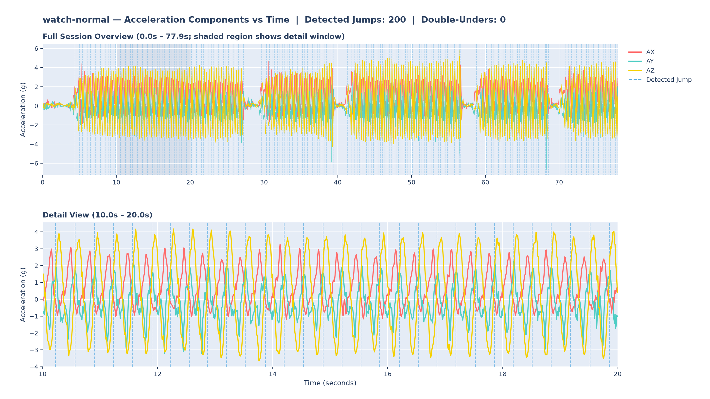
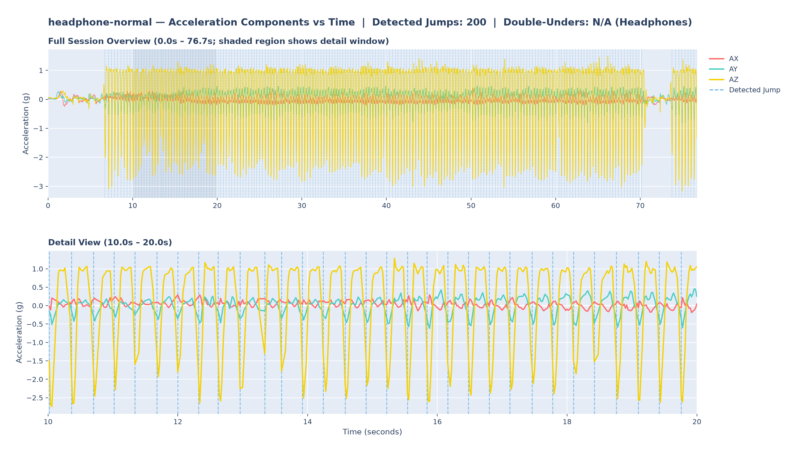
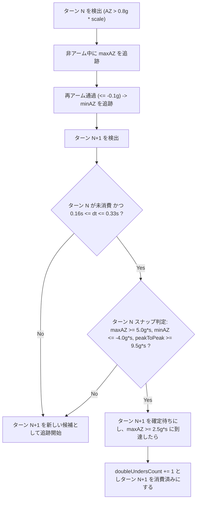
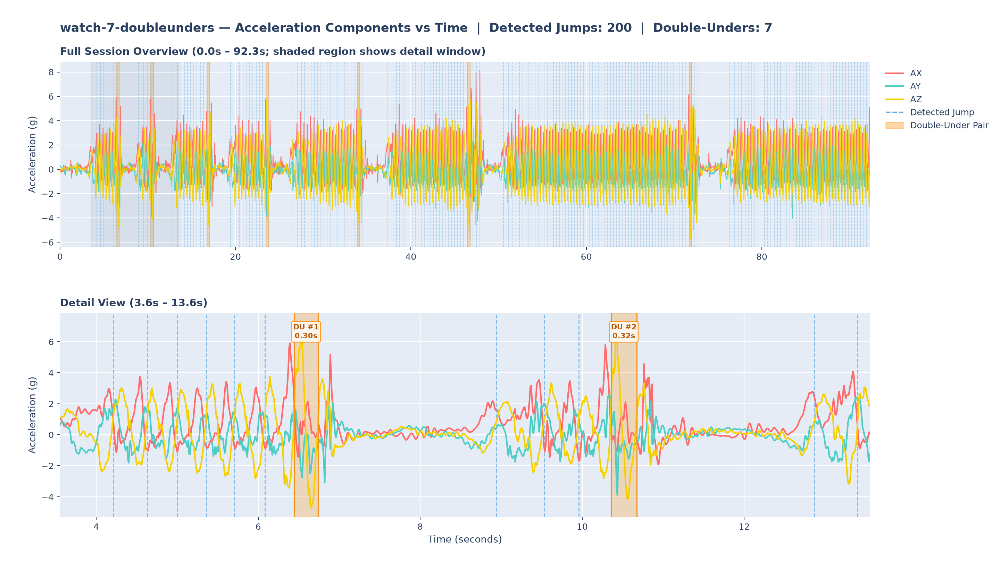
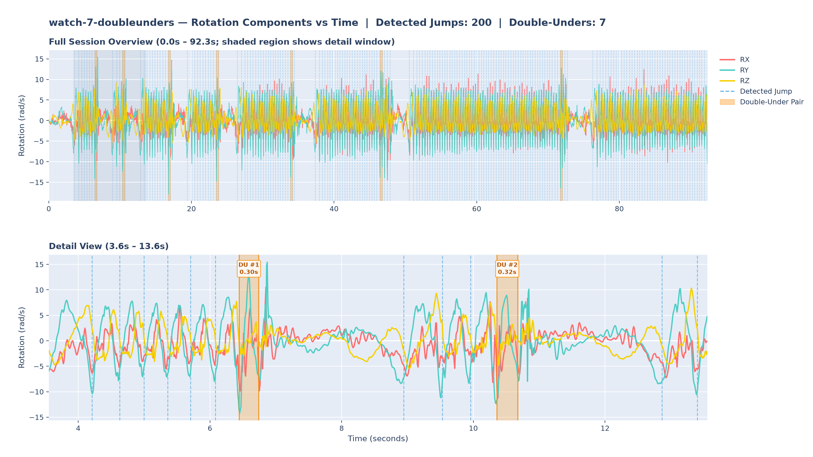
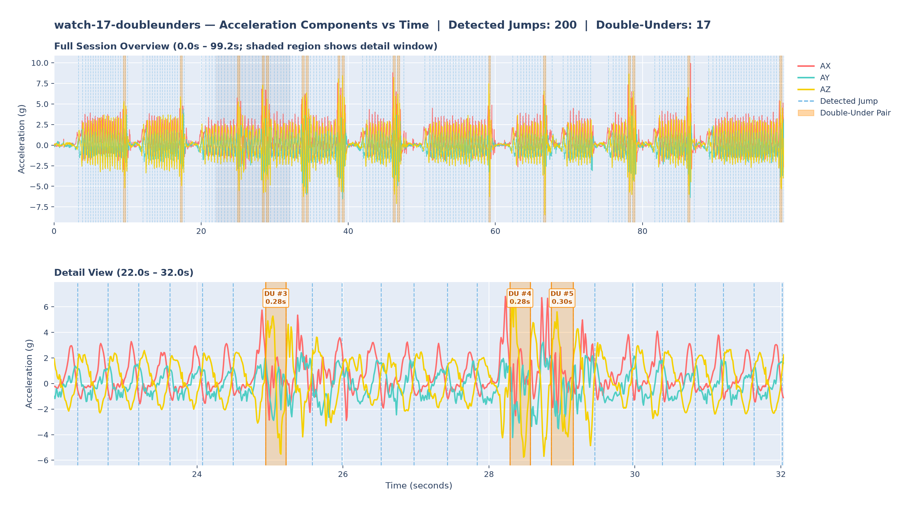
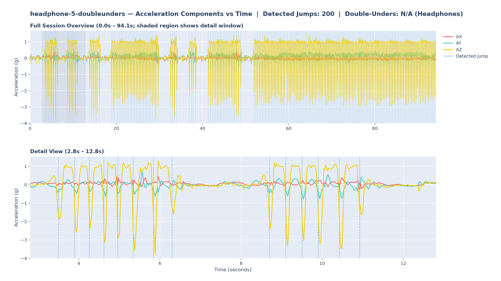

# ジャンプ・二重跳び（Double-Under）検出ロジック解説

*Languages: [English](jump-detection.md) | [日本語](jump-detection-jp.md)*

本ドキュメントでは、JumpRec が **Apple Watch** および **対応ヘッドホン（AirPods 等）** の Core Motion センサーストリームから、通常跳び（シングルアンダー）と二重跳び（ダブルアンダー）をリアルタイムに検出する仕組み、装着部位による物理信号の違い、および実測データを用いた検証結果について説明します。

---

## 1. アーキテクチャと関連ソースファイル

ジャンプ検出は単一の状態機械（ステートマシン）によるコア検出器と、セッション集計用の計算ロジックで構成されています。

| コンポーネント | 役割 | ソースファイル |
| :--- | :--- | :--- |
| **コア検出器** | リアルタイムのヒステリシス・ジャンプ検出 + Watch センサー確定型二重跳び検出 | [`JumpDetector.swift`](../JumpRecShared/logics/JumpDetector.swift) |
| **Watch モーション管理** | `CMMotionManager` で **100 Hz**（`0.01s` 間隔）のモーションを取得し、`doubleUndersCount` を公開 | [`MotionManager.swift (Watch)`](../JumpRec%20Watch%20App/Logics/MotionManager.swift) |
| **iPhone モーション管理** | `CMHeadphoneMotionManager` でヘッドホンモーション（約 **50 Hz** / `0.02s`）を取得 | [`MotionManager.swift (iPhone)`](../JumpRec/Logics/MotionManager.swift) |
| **タイムスタンプフォールバック・集計** | センサー確定値が無い場合にジャンプ時刻配列から `doubleUndersCount(from:)` を算出 | [`SessionMetricsCalculator.swift`](../JumpRecShared/logics/SessionMetricsCalculator.swift) |
| **Watch セッション終了処理** | `motionManager?.doubleUndersCount` を優先保存し、未取得時は `SessionMetricsCalculator` にフォールバック | [`AppState+SessionLifecycle.swift (Watch)`](../JumpRec%20Watch%20App/Models/AppState+SessionLifecycle.swift) |
| **通信フォールバック処理** | Watch から受信した `doubleUndersCount` を使用、または `jumpOffsets` から補完計算 | [`ConnectivityManager.swift (iPhone)`](../JumpRec/Logics/ConnectivityManager.swift) |
| **実データ回帰テスト** | 実測 CSV 5件を `JumpDetector` と `SessionMetricsCalculator` で自動再生テスト | [`JumpRecTests.swift`](../JumpRecTests/JumpRecTests.swift) |

---

## 2. センサーの物理特性：Apple Watch とヘッドホンの違い

どちらのデバイスも `CMDeviceMotion.userAcceleration`（重力成分を**除去**した線形加速度、単位 $g$）と `rotationRate`（角速度、単位 rad/s）を `MotionSample` に変換して処理します。しかし装着部位が全く異なるため、**Z軸加速度（`AZ`）**が捉える物理現象は根本的に異なります。

| プロファイル | 装着部位・サンプリング周波数 | 評価軸と極性 | 検出閾値 | 再アーム閾値 | 最小間隔 | 二重跳び検出の対応 |
| :--- | :--- | :--- | :--- | :--- | :--- | :--- |
| `.watch` | 手首（`100 Hz`） | `+AZ`（`positivePeak`） | `> +0.8g * scale` | `<= -0.1g` | `0.10s` | **対応**（手首のスナップ波形＋リズムフォールバック） |
| `.headphones` | 頭部（約 `50 Hz`） | `-AZ`（`negativeTrough`） | `< -1.2g * scale` | `>= +0.1g` | `0.10s` | **非対応**（`doubleUndersCount = nil`。詳細は[第5章](#5-なぜヘッドホンでは二重跳びを検出できないのか)） |

> **感度の調整（`sensitivityScale`）：** ユーザーは設定から `thresholdAdjustmentPercentage` を `[-50%, +50%]` の範囲で変更できます。検出器内部では `sensitivityScale = 1 + (percentage / 100)` として `adjustedThreshold = baseThreshold * sensitivityScale` を計算します（例：`+50%` では Watch の閾値が `+0.8g` → `+1.2g`、ヘッドホンの閾値が `-1.2g` → `-1.8g` に変わります）。

### 各デバイスで `AZ` が物理的に捉えているもの

* **Apple Watch（手首 — ロープの回転）：**
  手首を振ってロープを1回転させるたびに、遠心力とスナップ加速度によって鋭い**正の `AZ` ピーク**（通常跳びで `+2.5g` ～ `+4.5g`）と、それに続く**負の振り戻しトラフ（谷）**（`-2.0g` ～ `-3.8g`）が発生します。つまり、1回のジャンプでロープを1回回せば **1ピーク**、空中で2回回す二重跳びでは **2ピーク**が記録されます。
* **ヘッドホン（頭部 — 体幹の上下運動）：**
  Core Motion のセンサーフュージョンにより重力加速度（`-1g`）が差し引かれているため、以下のような波形になります。
  * **空中の自由落下中：** 頭部は空間内で `-1g` で落下しているため、`userAcceleration.z` は **`+1.0g` の平坦なプラトー（台地）**になります（実加速度 `0g` － 重力基準 `-1g` ＝ `+1.0g`）。
  * **着地・踏み切り時：** 地面反力で体が上向きに押し返されるため、鋭い**負の `AZ` トラフ**（`-2.0g` ～ `-3.8g`）が現れます。

---

## 3. 単発ジャンプ検出のステートマシン（`JumpDetector`）

高周波の振動や幅広いピークを1回のジャンプで二重カウントしないよう、[`JumpDetector.processMotionSample(_:)`](../JumpRecShared/logics/JumpDetector.swift#L133-L177) は**ヒステリシス（シュミットトリガ）＋不応期タイマー**で動作します。



1. **アーム状態の確認（`canDetectNextJump`）：** ジャンプを1回検出すると `canDetectNextJump = false` になり、信号が反対方向の `rearmThreshold`（Watch は `<= -0.1g`、ヘッドホンは `>= +0.1g`）を通過するまで次のトリガを受け付けません。
2. **閾値判定：** アーム中に Watch では `AZ > adjustedThreshold`（初期値 `+0.8g`）、ヘッドホンでは `AZ < adjustedThreshold`（初期値 `-1.2g`）を超えると候補になります。
3. **不応期ガード（`minimumInterval = 0.10s`）：** 前回確定したジャンプから `100 ms` 未満（`> 600 RPM` 相当）の連続発火をブロックします。

### 通常跳び（シングルアンダー）の実測波形

以下は [`Analysis/plot.py`](../Analysis/plot.py) で生成した各200回セッションの実測グラフです（水色の破線が検出されたジャンプ時刻）。





---

## 4. Apple Watch における二重跳び検出

### 単純な時間間隔しきい値だけでは失敗する理由

以前のバージョンでは、Watch の連続する2つのトリガ間隔が `<= 0.25s`（$\ge 240\text{ RPM}$）であれば二重跳びと判定していました。しかし実測データ（[`watch-normal.csv`](../Analysis/motion-data/watch-normal.csv)、[`watch-7-doubleunders.csv`](../Analysis/motion-data/watch-7-doubleunders.csv)、[`watch-17-doubleunders.csv`](../Analysis/motion-data/watch-17-doubleunders.csv)）を分析した結果、以下の **3つの課題** が明らかになりました。

1. **一般的な二重跳びの間隔（`0.26s – 0.32s`）が高速シングルと重複する：**
   * `watch-7-doubleunders.csv` に含まれる二重跳び7回は、すべてトリガ間隔が **`0.269s ～ 0.319s`** であり、`0.25s` 上限では **0回** しか検出されませんでした。
   * `watch-17-doubleunders.csv` でも17回中16回が **`0.259s ～ 0.319s`**（`0.25s` 以下は `0.249s` の1回のみ）でした。
   * 一方で、`watch-normal.csv` の高速シングル跳びでも **`0.299s ～ 0.319s`** に達する区間があるため、単に上限を `0.32s` へ引き上げると通常跳びから **42件もの誤検出** が発生します。
2. **立ち上がりエッジ検出による間隔の伸び（`+30ms ～ +70ms`）：**
   * `JumpDetector` はリアルタイム性を優先し、ピーク時刻ではなく `AZ > +0.8g` を最初に超えた**立ち上がりエッジ**でタイムスタンプを記録します。
   * 二重跳びの **1回転目** は、ジャンプの予備動作から比較的緩やかに立ち上がるため、ピークの `80–100 ms` 前に `+0.8g` を横切ります。
   * 1回転目と2回転目の間では手首が `-4g ～ -8g` の深い谷へ急激に振り下ろされ、そこから一気に跳ね上がるため、**2回転目** はピークのわずか `30–50 ms` 前に `+0.8g` を横切ります。
   * この非対称性により、実際のピーク間隔が `0.21s – 0.25s` であっても、トリガ間隔としては **`0.26s – 0.31s`** に引き伸ばされて観測されます。
3. **ロープ引っかかりによるスプリットピーク（`dt ≈ 0.12s`）：**
   * `watch-normal.csv` の引っかかり時（`56.48s` と `68.17s`）に、ロープが靴に当たった瞬間だけ `10 ms` ほど `-0.1g` を下回るノイズが発生し、同じジャンプの後半部分が `dt = 0.119s` で再トリガされました。`0.25s` 上限のみの場合、この引っかかり2回が二重跳び2回として誤カウントされていました。

### 実測データによる分離性：高速シングル vs. 二重跳び

回転運動の遠心加速度は角速度の2乗に比例する（$a = \omega^2 r$）ため、1回の滞空中にロープを2回回す二重跳びでは、タイミングが高速シングルと重なっていても Watch センサー上の振幅に明確な差が現れます。

| 指標（Watch 1回転あたり） | 高速シングル跳び（`watch-normal.csv`、`0.30s–0.32s`） | 二重跳び確定ターン（`watch-7`・`watch-17`） |
| :--- | :--- | :--- |
| **ターン間隔（`dt_trigger`）** | `0.299s – 0.319s` | `0.249s – 0.319s` |
| **1回転目ピーク（`maxAZ`）** | `3.0g – 5.01g`（中央値 `4.05g`） | **`5.06g – 8.66g`** |
| **ターン間の谷（`minAZ`）** | `-2.5g – -3.99g`（中央値 `-3.28g`） | **`-4.17g – -8.47g`** |
| **1回転目ピーク・トゥ・ピーク（`maxAZ - minAZ`）** | `<= 9.00g` | **`9.77g – 15.04g`** |
| **手首の角速度ノルム（`\|R\|`）** | `8.0 – 11.4 rad/s`（中央値 `9.30`） | **`13.6 – 23.2 rad/s`** |
| **直前ターン比のペース変化（`dt / base`）** | `0.88x – 1.00x`（徐々に加速） | **`0.58x – 0.85x`**（急激な短縮） |

### 第1層（プライマリ）：`JumpDetector` による手首スナップ確定方式

`.watch` プロファイルでは、ジャンプカウントの応答性や閾値を変えることなく、[`JumpDetector`](../JumpRecShared/logics/JumpDetector.swift) 内部で各ターンの波形エンベロープを監視して二重跳びを確定します。



* **スプリットピーク除外：** `dt >= 0.16s`（`watchDoubleUnderMinimumInterval`）により、`160 ms` 未満の引っかかり振動（`> 375 RPM`）を排除します。
* **2ターン目による確定：** 2回転目が実際に `maxAZ >= 2.5g * sensitivityScale` に到達した時点でカウントするため、1回の強い着地・引っかかり単体での誤カウントを防ぎます。
* **非重複ペアリング：** ターン $N$ と $N+1$ で1回の二重跳びが成立すると $N+1$ を消費済み（`isActiveWatchTurnConsumedForDoubleUnder = true`）にするため、連続二重跳び（4回の高速回転）も `(1, 2)` と `(3, 4)` の2回として正しく数えられます。
* **直後に引っかかっても有効：** 手首の2回転を直接捉えているため、2回転目を回しきった直後にロープが足に引っかかって中断しても、その二重跳びは確実にカウントされます。

以下の実測グラフでは、二重跳びの激しい手首スナップ（加速度 `+5g ～ +8.6g`、角速度 `> 15 rad/s`）がオレンジ色の帯として正確に強調表示されています。







### 第2層（フォールバック）：`SessionMetricsCalculator` によるリズム変化検出

生の IMU サンプルが無く `jumpOffsets: [TimeInterval]` のみから集計する経路（[`SessionMetricsCalculator.doubleUndersCount(from:)`](../JumpRecShared/logics/SessionMetricsCalculator.swift#L138-L204) や単体テスト・レガシーデータ補完）では、以下のタイムスタンプベースのアルゴリズムが動作します。

1. **スプリットピークの統合：** 直前の確定オフセットとの差が `0.16s` 未満（`doubleUnderLowerBound`）のイベントは同一ジャンプの分裂とみなしスキップします。
2. **休憩・引っかかり時のベースライン初期化：** `0.80s` を超える間隔（`doubleUnderStreakResetGap`）が空いた場合、通常跳びの直近ペース履歴（`recentSingleIntervals`）をリセットします。二重跳び直後に足を引っ掛けて休憩した場合でも、次の再スタートが古いペースと比較されないよう、ペア消費時（`index += 2`）にスキップされる区間もチェックしてリセットします。
3. **二重跳びペア判定（いずれかを満たす場合）：**
   * **無条件の高速ペア：** `0.16s <= interval <= 0.25s`
   * **相対リズム低下ペア：** `0.16s <= interval <= 0.325s` **かつ** `interval <= 0.84 * 直近2回のシングル間隔の平均`（通常跳び間隔は `0.29s ... 0.50s` の範囲で追跡）
4. **両ターンを消費（`index += 2`）：** 重複ペアリングを防ぎつつ、連続二重跳び中も直前の通常跳びベースラインを保持して比較できます。

---

## 5. なぜヘッドホンでは二重跳びを検出できないのか

ヘッドホンのモーションストリーム（`CMHeadphoneMotionManager`、約 `50 Hz`）が測定しているのは**頭部の動き（＝体全体のジャンプ軌道）のみ**であり、手首やロープの回転とは物理的に切り離されています。

二重跳びを試みて7回すべてで直後に引っかかった実測データ [`headphone-5-doubleunders.csv`](../Analysis/motion-data/headphone-5-doubleunders.csv) の波形を確認すると、その限界が明確に分かります。



1. **体の上下1回につき谷（`AZ < -1.2g`）も1回だけ：** 空中でロープが2回通過しても、体の離陸と着地は1回だけです。そのため `jumpCount` も（ロープ回転数ではなく）ジャンプ回数として **+1** しか増えず、ペアリングすべき2つ目のピークが存在しません。
2. **滞空中の信号は完全に平坦：** 高く跳ぶため滞空時間は通常の `0.34s` から `0.46s – 0.58s` へと長くなりますが、その約 `350 ms` の空中区間では `AZ` が `+1.0g` で平らになるだけで、加速度にも角速度（`RX, RY, RZ`）にもロープ回転を示す波紋は現れません。
3. **高めのシングル跳び・失敗試行との区別が不可能：** `0.46s – 0.58s` の滞空時間や `-3.2g ～ -3.8g` の強めの着地は、引っかかり直後の立て直しジャンプ（`0.44s – 0.48s`）や、「高く跳んだものの2回転目が通る前に引っかかった失敗試行」でも同じように発生します。

したがってヘッドホン単体では「二重跳びを成功させた」のか「ただ高く跳んだだけ／途中で引っかかった」のかを区別する情報が存在しないため、JumpRec ではヘッドホン計測時の `doubleUndersCount` を意図的に `nil`（UI上は `--`）とし、二重跳びの集計と自己ベスト（PR）記録を Apple Watch セッション専用としています。

---

## 6. ベンチマークデータと検証結果

[`Analysis/motion-data/`](../Analysis/motion-data) に保存されている全5件の実測 CSV（各200ジャンプ）と、[`JumpRecTests.swift`](../JumpRecTests/JumpRecTests.swift#L315-L338) の自動回帰テスト結果は以下の通りです。

| データセット | デバイス・周波数 | 時間 | 実際の動作内容 | `JumpDetector` ジャンプ数 | `JumpDetector` 二重跳び数 | `SessionMetricsCalculator` フォールバック |
| :--- | :--- | :--- | :--- | :---: | :---: | :---: |
| [`watch-normal.csv`](../Analysis/motion-data/watch-normal.csv) | Watch (`100 Hz`) | `77.9s` | 通常跳び200回（高速区間・引っかかり2回含む）、二重跳び 0回 | `200` | **`0`** | **`0`** |
| [`watch-7-doubleunders.csv`](../Analysis/motion-data/watch-7-doubleunders.csv) | Watch (`100 Hz`) | `92.3s` | 二重跳び 7回（多くは直後に引っかかり） | `200` | **`7`** | **`7`** |
| [`watch-17-doubleunders.csv`](../Analysis/motion-data/watch-17-doubleunders.csv) | Watch (`100 Hz`) | `99.2s` | 二重跳び 17回（11バースト中、単発・連続含む） | `200` | **`17`** | **`16`** |
| [`headphone-normal.csv`](../Analysis/motion-data/headphone-normal.csv) | ヘッドホン (`50 Hz`) | `76.7s` | 通常跳び200回、二重跳び 0回 | `200` | N/A | N/A |
| [`headphone-5-doubleunders.csv`](../Analysis/motion-data/headphone-5-doubleunders.csv) | ヘッドホン (`50 Hz`) | `94.1s` | 二重跳び試行約5～7回（各試行の後に引っかかり） | `200` | N/A | N/A |

### グラフの再生成方法

[`Analysis/results/`](../Analysis/results) 内の PNG 画像を再生成するには、リポジトリルートで以下を実行します。

```sh
python3 Analysis/plot.py
```
