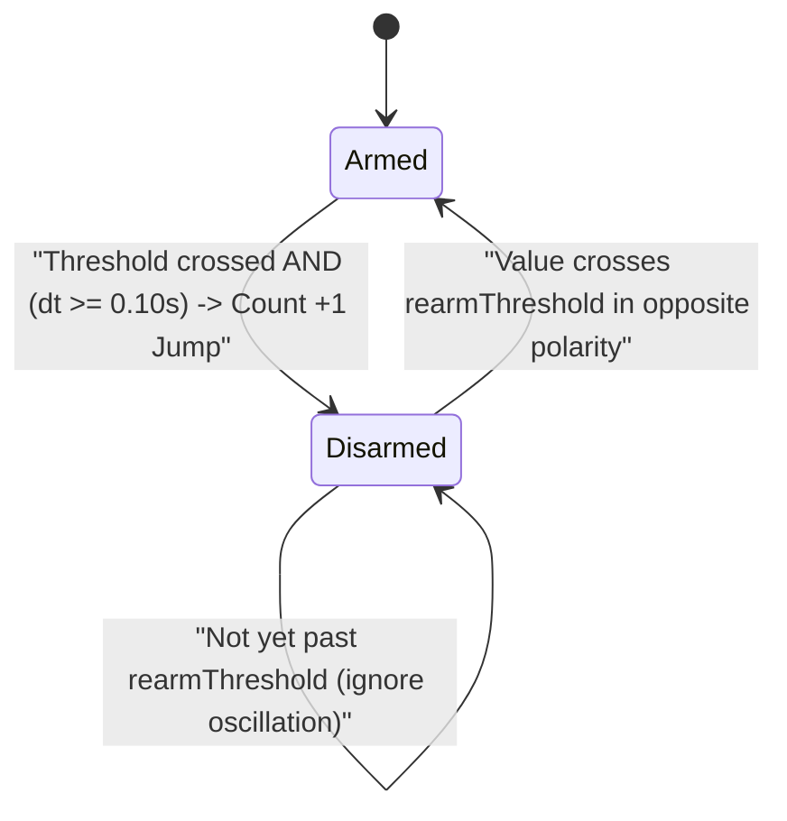
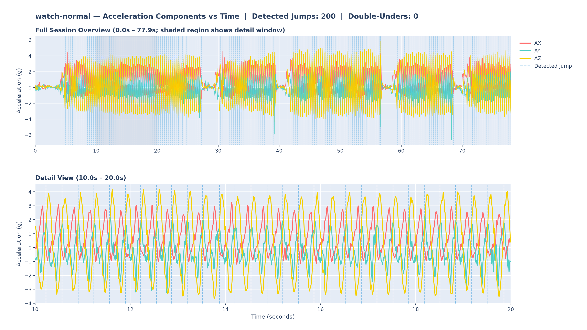
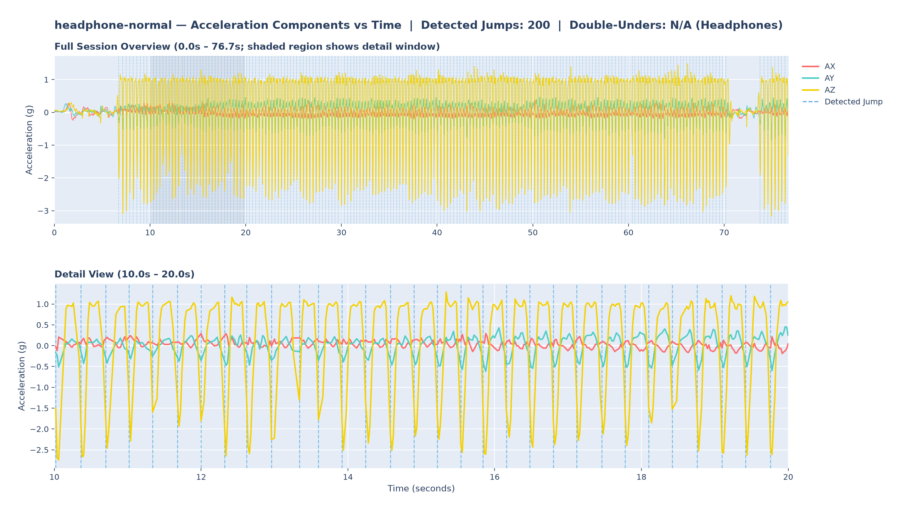
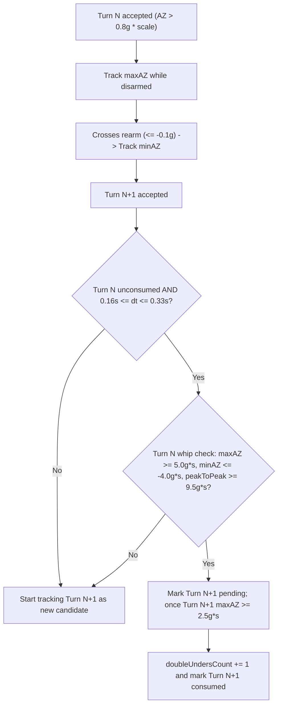
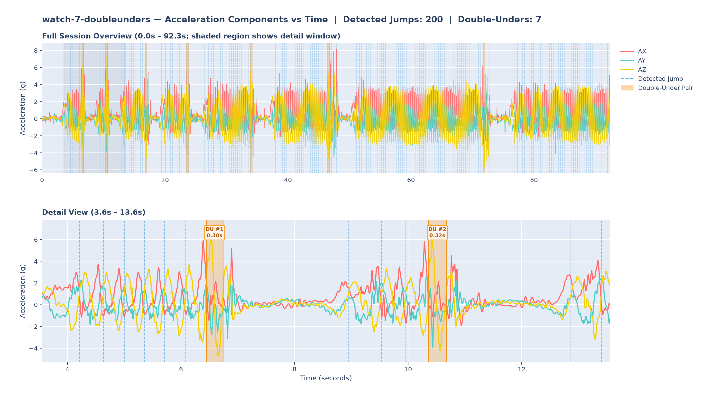
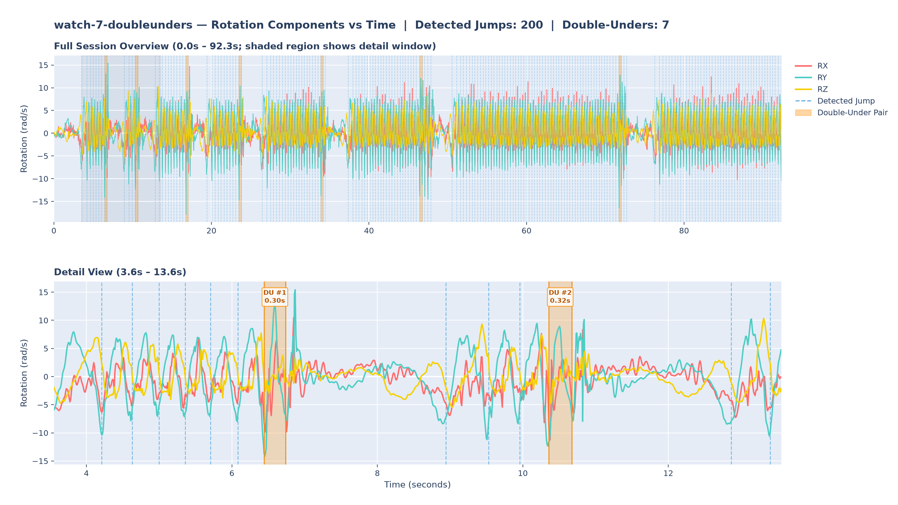
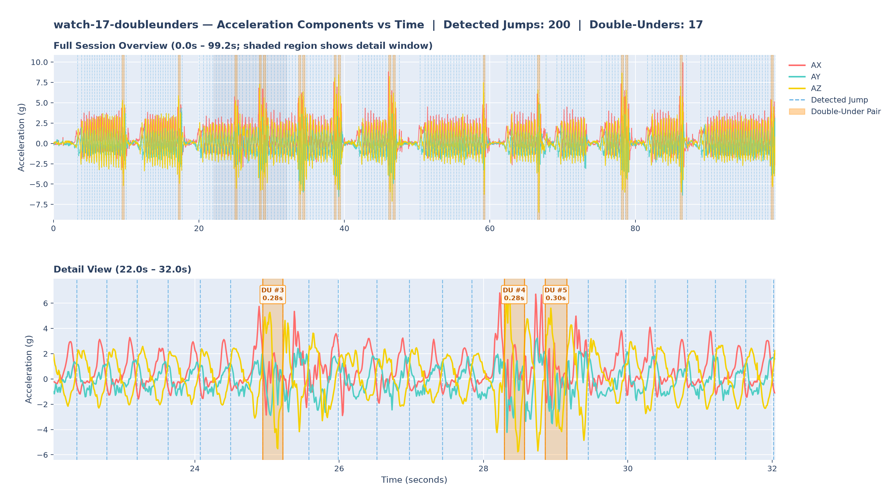
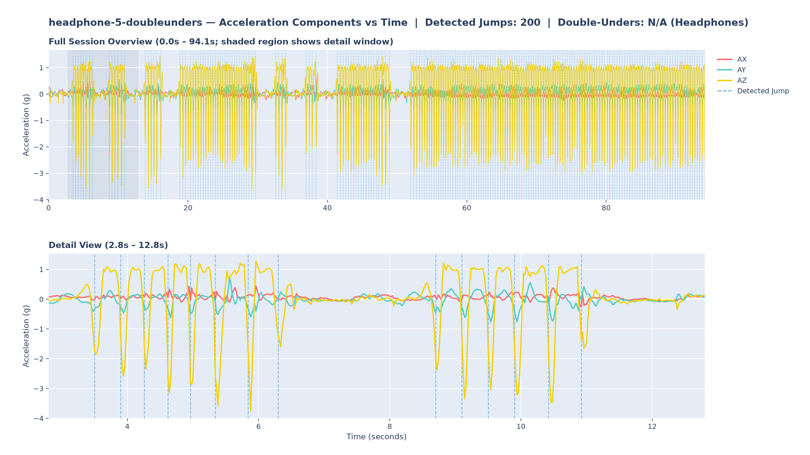

# Jump & Double-Under Detection

*Languages: [English](jump-detection.md) | [日本語](jump-detection-jp.md)*

This document explains how JumpRec detects single-unders and double-unders in real time from Core Motion sensor streams on **Apple Watch** and **compatible headphones**, why the two wear locations produce fundamentally different signals, and how the thresholds are verified against real workout recordings.

---

## 1. Architecture & Source Files

Jump detection is shared across platforms through a single state-machine detector plus a session-level metrics calculator:

| Component | Role | Source |
| :--- | :--- | :--- |
| **Core Detector** | Real-time hysteresis jump trigger + Watch sensor-confirmed double-under detector | [`JumpDetector.swift`](../JumpRecShared/logics/JumpDetector.swift) |
| **Watch Motion Manager** | Streams `CMMotionManager` device motion at **100 Hz** (`0.01s`) and exposes `doubleUndersCount` | [`MotionManager.swift (Watch)`](../JumpRec%20Watch%20App/Logics/MotionManager.swift) |
| **iPhone Motion Manager** | Streams `CMHeadphoneMotionManager` device motion (~**50 Hz**, `0.02s`) | [`MotionManager.swift (iPhone)`](../JumpRec/Logics/MotionManager.swift) |
| **Timestamp Fallback & Metrics** | Computes `doubleUndersCount(from:)` from jump timestamps when sensor confirmation isn't present | [`SessionMetricsCalculator.swift`](../JumpRecShared/logics/SessionMetricsCalculator.swift) |
| **Watch Session End** | Saves `motionManager?.doubleUndersCount`, falling back to `SessionMetricsCalculator` | [`AppState+SessionLifecycle.swift (Watch)`](../JumpRec%20Watch%20App/Models/AppState+SessionLifecycle.swift) |
| **Connectivity Fallback** | Accepts Watch `doubleUndersCount` or computes fallback from `jumpOffsets` | [`ConnectivityManager.swift (iPhone)`](../JumpRec/Logics/ConnectivityManager.swift) |
| **Real-Data Regression Tests** | Replays all 5 recorded CSVs through `JumpDetector` and `SessionMetricsCalculator` | [`JumpRecTests.swift`](../JumpRecTests/JumpRecTests.swift) |

---

## 2. Sensor Physics: Apple Watch vs. Headphones

Both platforms feed `CMDeviceMotion.userAcceleration` (linear acceleration with gravity **removed**, in $g$) and `rotationRate` (rad/s) into `MotionSample`. However, because the sensors sit on completely different parts of the body, the **Z-axis acceleration (`AZ`)** captures two distinct physical events:

| Profile | Wear Location & Rate | Signal Axis & Polarity | Trigger Threshold | Re-arm Threshold | Minimum Interval | Double-Under Support |
| :--- | :--- | :--- | :--- | :--- | :--- | :--- |
| `.watch` | Wrist (`100 Hz`) | `+AZ` (`positivePeak`) | `> +0.8g * scale` | `<= -0.1g` | `0.10s` | **Yes** (sensor whip + cadence fallback) |
| `.headphones` | Head (`~50 Hz`) | `-AZ` (`negativeTrough`) | `< -1.2g * scale` | `>= +0.1g` | `0.10s` | **No** (`doubleUndersCount = nil`; see [Section 5](#5-why-headphones-cannot-detect-double-unders)) |

> **Sensitivity scaling:** Users can tune sensitivity via `thresholdAdjustmentPercentage` in `[-50%, +50%]`. This computes `sensitivityScale = 1 + (percentage / 100)`, scaling `adjustedThreshold = baseThreshold * sensitivityScale` (for example, `+50%` raises Watch's trigger from `+0.8g` to `+1.2g`, and makes Headphones' trigger `-1.8g`).

### What `AZ` Physically Measures on Each Device

* **Apple Watch (Wrist — Rope Revolutions):**
  Each time the wrist flicks the rope downward/around, centripetal and whip acceleration produce a sharp **positive `AZ` spike** (`+2.5g` to `+4.5g` on single-unders) followed by a **negative swing trough** (`-2.0g` to `-3.8g`). Thus, one jump with one rope turn produces **1 positive peak**; a double-under with two wrist flicks produces **2 positive peaks** while airborne.
* **Headphones (Head — Vertical Body Motion):**
  Because gravity (`-1g`) is subtracted by Core Motion sensor fusion:
  * During **free-fall in midair**, a falling head accelerates at `-1g` in world space, so `userAcceleration.z` flattens into a **`+1.0g` plateau** (`1g - 1g = 0g` total minus `-1g` subtracted gravity = `+1.0g`).
  * At **landing and takeoff**, the legs push upward against the ground, producing a sharp **negative `AZ` trough** (`-2.0g` to `-3.8g`).

---

## 3. Single-Jump Detection State Machine (`JumpDetector`)

To avoid counting high-frequency vibration or broad acceleration plateaus multiple times, [`JumpDetector.processMotionSample(_:)`](../JumpRecShared/logics/JumpDetector.swift#L133-L177) uses a **hysteresis (Schmitt-trigger) + refractory timer** state machine:



1. **Armed Check (`canDetectNextJump`):** Once a jump fires, `canDetectNextJump` becomes `false`. Future samples are ignored for jump triggering until the signal crosses back past `rearmThreshold` (`<= -0.1g` on Watch, `>= +0.1g` on Headphones).
2. **Threshold Check:** When armed, Watch triggers as soon as `AZ > adjustedThreshold` (`+0.8g` default), and Headphones trigger when `AZ < adjustedThreshold` (`-1.2g` default).
3. **Refractory Guard (`minimumInterval = 0.10s`):** Rejects triggers closer than `100 ms` to the previous accepted jump (`> 600 RPM`).

### Normal Single-Under Waveforms

The plots below (generated from real 200-jump sessions via [`Analysis/plot.py`](../Analysis/plot.py)) show steady single-under jumping with dashed blue lines at each accepted jump trigger:





---

## 4. Double-Under Detection on Apple Watch

### Why Simple Timestamp Thresholds Fail in Practice

Early versions of JumpRec counted a double-under whenever two Watch jump timestamps occurred within `<= 0.25s` ($\ge 240\text{ RPM}$). Analyzing real Watch recordings ([`watch-normal.csv`](../Analysis/motion-data/watch-normal.csv), [`watch-7-doubleunders.csv`](../Analysis/motion-data/watch-7-doubleunders.csv), and [`watch-17-doubleunders.csv`](../Analysis/motion-data/watch-17-doubleunders.csv)) revealed **three causes** of missed detections and false positives:

1. **Non-elite double-under intervals overlap fast single-unders (`0.26s – 0.32s`):**
   * In `watch-7-doubleunders.csv`, all 7 completed double-unders had trigger intervals between **`0.269s` and `0.319s`** (`0` detected under a `0.25s` cutoff).
   * In `watch-17-doubleunders.csv`, 16 of 17 double-unders had trigger intervals between **`0.259s` and `0.319s`** (only 1 at `0.249s` was detected).
   * Meanwhile, fast single-under sprinting in `watch-normal.csv` also reached **`0.299s – 0.319s`**, so simply raising the interval cutoff to `0.32s` creates **42 false positives** on normal jumping.
2. **Rising-edge trigger asymmetry stretches measured intervals by `+30ms` to `+70ms`:**
   * `JumpDetector` timestamps each turn at the *rising-edge* crossing (`AZ > +0.8g`) rather than the peak so live UI feedback has minimal latency.
   * On the **1st turn** of a double-under, `AZ` rises gradually out of the previous bounce and crosses `+0.8g` roughly `80–100 ms` before its peak.
   * Between the 1st and 2nd turn, the wrist whips violently through a deep trough (`-4.2g` to `-8.5g`) and snaps back across `+0.8g` only `30–50 ms` before the 2nd peak.
   * As a result, a true peak-to-peak turn spacing of `0.21s – 0.25s` measures as **`0.26s – 0.31s`** at the `+0.8g` rising edge.
3. **Rope-snag split peaks (`dt ≈ 0.12s`):**
   * During a trip in `watch-normal.csv` (at `56.48s` and `68.17s`), the rope hitting the shoes caused a single `10 ms` vibration dip below `-0.1g` (`rearmThreshold`) `~0.11s` after trigger, allowing the tail of the same jump to re-trigger at `dt = 0.119s`. With a `0.25s` cutoff, those two trips were falsely counted as 2 double-unders.

### Empirical Separation: Fast Single-Unders vs. Double-Unders

Because centripetal wrist acceleration grows with the square of angular velocity ($a = \omega^2 r$), whipping the rope twice in one jump creates a distinct physical signature on the Watch IMU even when turn timing overlaps fast single-unders:

| Metric (per Watch Turn) | Normal Fast Single-Unders (`watch-normal.csv`, `0.30s–0.32s`) | Confirmed Double-Unders (`watch-7` & `watch-17`) |
| :--- | :--- | :--- |
| **Turn-to-turn interval (`dt_trigger`)** | `0.299s – 0.319s` | `0.249s – 0.319s` |
| **1st turn peak (`maxAZ`)** | `3.0g – 5.01g` (median `4.05g`) | **`5.06g – 8.66g`** |
| **Inter-turn trough (`minAZ`)** | `-2.5g – -3.99g` (median `-3.28g`) | **`-4.17g – -8.47g`** |
| **1st turn peak-to-peak (`maxAZ - minAZ`)** | `<= 9.00g` | **`9.77g – 15.04g`** |
| **Wrist rotation magnitude (`\|R\|`)** | `8.0 – 11.4 rad/s` (median `9.30`) | **`13.6 – 23.2 rad/s`** |
| **Cadence vs. preceding turns (`dt / base`)** | `0.88x – 1.00x` (gradual speedup) | **`0.58x – 0.85x`** (abrupt drop) |

### Layer 1 (Primary): Sensor-Confirmed Wrist-Whip Detection in `JumpDetector`

For `.watch` sessions, [`JumpDetector`](../JumpRecShared/logics/JumpDetector.swift) inspects the waveform envelope around each accepted turn without changing jump-counting sensitivity or latency:



* **Split-peak immunity:** `dt >= 0.16s` (`watchDoubleUnderMinimumInterval`) rejects sub-`160 ms` trip vibrations (`> 375 RPM`).
* **Two-turn confirmation:** A double-under is only incremented once the second turn actually develops (`maxAZ >= 2.5g * sensitivityScale`), preventing a single hard trip impact from counting by itself.
* **Non-overlapping pairing:** When Turn $N$ and Turn $N+1$ confirm a double-under, Turn $N+1$ is marked consumed (`isActiveWatchTurnConsumedForDoubleUnder = true`) so consecutive double-unders (4 rapid turns = 2 double-unders) pair cleanly as `(1, 2)` and `(3, 4)` rather than `(1, 2)`, `(2, 3)`, `(3, 4)`.
* **Works even if you trip afterward:** Because `JumpDetector` tracks wrist revolutions directly, a completed double-under followed immediately by a trip still registers both turns and confirms the double-under.

The graphs below show these exact wrist-whip spikes (`+5g` to `+8.6g` acceleration and `> 15 rad/s` rotation) highlighted in orange:







### Layer 2 (Fallback): Streak-Aware Cadence Drop in `SessionMetricsCalculator`

When only `jumpOffsets: [TimeInterval]` are available (for example, in [`SessionMetricsCalculator.doubleUndersCount(from:)`](../JumpRecShared/logics/SessionMetricsCalculator.swift#L139-L204) or tests/payloads without raw IMU samples), a timestamp-only detector runs:

1. **Collapse split-peak glitches:** Any jump offset `< 0.16s` (`doubleUnderLowerBound`) after the previous accepted offset is skipped so a rope-snag split peak cannot pair with either neighbor.
2. **Reset cadence baseline on breaks:** Any gap `> 0.80s` (`doubleUnderStreakResetGap`) clears the local single-under baseline (`recentSingleIntervals`) — including gaps immediately *after* a consumed double-under pair so post-trip jumps are never compared against pre-trip cadence.
3. **Pair turns when either condition holds:**
   * **Unconditional fast pair:** `0.16s <= interval <= 0.25s`.
   * **Adaptive cadence drop:** `0.16s <= interval <= 0.325s` **and** `interval <= 0.84 * mean(last 2 single-under intervals)` where single-under intervals are tracked in `0.29s ... 0.50s`.
4. **Consume both turns (`index += 2`):** Prevents overlapping pairs while retaining the pre-burst single-under baseline across consecutive double-unders.

---

## 5. Why Headphones Cannot Detect Double-Unders

Headphone motion streams (`CMHeadphoneMotionManager` at `~50 Hz`) measure **head/body motion only** — there is no mechanical coupling to the wrists or rope revolutions.

In [`headphone-5-doubleunders.csv`](../Analysis/motion-data/headphone-5-doubleunders.csv) (where 7 double-under attempts caused trips right afterward), inspecting the raw signal reveals what headphones actually observe:



1. **One body jump = one trough (`AZ < -1.2g`):** While the rope passes under the feet twice, the body still takes off once and lands once. Total `jumpCount` increases by **1** per double-under attempt rather than **2**, and there is no second impact trough to pair.
2. **Flat free-fall plateau while airborne:** During the `~350 ms` hang time of a higher jump (`dt = 0.46s – 0.58s` vs. `0.34s` normal), `AZ` remains flat near `+1.0g` and gyroscope rates (`RX, RY, RZ`) stay low — there is no wrist-whip ripple in head acceleration or rotation.
3. **Ambiguity with high single-unders and failed attempts:** A slightly higher flight time (`0.46s – 0.58s`) and heavier landing (`-3.2g` to `-3.8g`) also occur on high single-under recovery bounces (`0.44s – 0.48s`) and on failed double-unders where the jumper jumped high enough but snagged the rope before completing the second turn.

Because headphones cannot reliably distinguish a completed double-under from a high single-under or a failed attempt, JumpRec intentionally reports `doubleUndersCount = nil` (`--` in UI) for headphone-tracked sessions and restricts double-under tracking and Personal Records to Apple Watch sessions.

---

## 6. Benchmark Datasets & Verification

All five real-world datasets (200 detected jumps each) live in [`Analysis/motion-data/`](../Analysis/motion-data) and are tested automatically in [`JumpRecTests.swift`](../JumpRecTests/JumpRecTests.swift#L315-L338):

| Dataset | Device & Rate | Duration | Actual Events | `JumpDetector` Jumps | `JumpDetector` DUs | `SessionMetricsCalculator` Fallback DUs |
| :--- | :--- | :--- | :--- | :---: | :---: | :---: |
| [`watch-normal.csv`](../Analysis/motion-data/watch-normal.csv) | Watch (`100 Hz`) | `77.9s` | 200 single jumps (incl. fast sprints & 2 snags), 0 DUs | `200` | **`0`** | **`0`** |
| [`watch-7-doubleunders.csv`](../Analysis/motion-data/watch-7-doubleunders.csv) | Watch (`100 Hz`) | `92.3s` | 7 single double-unders (most followed by trips) | `200` | **`7`** | **`7`** |
| [`watch-17-doubleunders.csv`](../Analysis/motion-data/watch-17-doubleunders.csv) | Watch (`100 Hz`) | `99.2s` | 17 double-unders across 11 bursts | `200` | **`17`** | **`16`** |
| [`headphone-normal.csv`](../Analysis/motion-data/headphone-normal.csv) | Headphones (`50 Hz`) | `76.7s` | 200 single jumps, 0 DUs | `200` | N/A | N/A |
| [`headphone-5-doubleunders.csv`](../Analysis/motion-data/headphone-5-doubleunders.csv) | Headphones (`50 Hz`) | `94.1s` | ~5–7 high double-under attempts before trips | `200` | N/A | N/A |

### Regenerating Analysis Graphs

To re-run the analysis and regenerate all PNG graphs in [`Analysis/results/`](../Analysis/results):

```sh
python3 Analysis/plot.py
```
