```mermaid
sequenceDiagram
    autonumber
    actor User
    participant Home as HomeView (iPhone)
    participant State as JumpRecState (iPhone)
    participant Motion as MotionManager (iPhone)
    participant HK as PhoneWorkoutManager / HealthKit
    participant Store as MyDataStore & LiveActivity

    User->>Home: Tap "START WORKOUT"
    Home->>Home: Check free workout quota
    Home->>HK: WorkoutPermissions.prepareForWorkout(requestMotion: true)
    HK-->>Home: Permissions granted

    rect rgb(35, 55, 75)
        Note over Home,HK: 3-Second Countdown & Hardware Pre-warming (t = -3s … 0s)
        Home->>State: prepareLocalSession(thresholdAdjustmentPercentage)
        State->>State: prepareHaptics() + warmUpSpeechSynthesizerIfNeeded()
        State->>Motion: prepareForWorkout() (isTracking = false)
        Motion->>Motion: Start iPhone & headphone CMDeviceMotion streams (sensor fusion settles)
        State->>HK: prepareWorkout()
        HK->>HK: Create HKWorkoutSession + HKLiveWorkoutBuilder, call session.prepare()
        Home->>Home: Animate 3 … 2 … 1 countdown ring
    end

    alt User taps "CANCEL" during countdown
        User->>Home: Tap "CANCEL"
        Home->>State: cancelPreparedLocalSession()
        State->>Motion: cancelPreparation() (stopDeviceMotionUpdates)
        State->>HK: discardWorkout() (session.end(), nothing saved)
    else Countdown reaches 0 (t = 0s)
        Home->>State: start(...) -> startLocalSession()
        State->>State: sessionState = .active, startTime = Date()
        State->>Motion: startTracking() (reset detectors, isTracking = true)
        State->>HK: startWorkout(at: startTime)
        HK->>HK: session.startActivity(with:) + builder.beginCollection(at:)
        State->>Store: Start Live Activity + speak("Workout Started!")

        loop Active Workout
            Motion->>State: onJumpDetected(.iPhone / .headphones)
            State->>State: Increment jumpCount, check 100-jump & 1-min landmarks
            HK->>State: onMetricsUpdated(calories, heartRate)
            State->>Store: Update Live Activity
        end

        User->>Home: Slide "STOP WORKOUT" (or goal reached)
        Home->>State: finish()
        State->>Motion: stopTracking()
        State->>State: sessionState = .complete, endTime = Date()
        State->>HK: endWorkout(at: endTime) (endCollection + finishWorkout)
        State->>Store: saveCompletedSession(...) to SwiftData + end Live Activity
    end
```

```mermaid
sequenceDiagram
    autonumber
    actor User
    participant Start as StartView (Watch)
    participant WState as JumpRecState (Watch)
    participant WMotion as MotionManager (Watch)
    participant WHK as WorkoutManager / HealthKit
    participant WC as ConnectivityManager (WCSession)

    User->>Start: Tap "START"
    Start->>Start: Check settings.isQuotaExceeded
    Start->>WHK: WorkoutPermissions.prepareForWorkout()
    WHK-->>Start: Permissions granted

    rect rgb(35, 55, 75)
        Note over Start,WHK: 3-Second Countdown & Hardware Pre-warming (t = -3s … 0s)
        Start->>WState: prepareForStart(thresholdAdjustmentPercentage)
        WState->>WState: prepareSpeechForWorkout() (silent AVSpeechSynthesizer warmup)
        WState->>WMotion: prepareForWorkout()
        WMotion->>WMotion: Start 40 Hz startDeviceMotionUpdates (isTracking = false)
        WMotion->>WHK: prepareWorkout()
        WHK->>WHK: Create HKWorkoutSession + HKLiveWorkoutBuilder
        WHK->>WHK: session.prepare() (warms up optical HR & calorie sensors)
        WHK->>WHK: Attempt startMirroringToCompanionDevice() (non-blocking)
        Start->>Start: Animate 3 … 2 … 1 countdown ring
    end

    alt StartView disappears before countdown completes
        Start->>WState: cancelPreparedStart()
        WState->>WMotion: cancelPreparation() (stopDeviceMotionUpdates)
        WMotion->>WHK: cancelPreparedWorkout() (session.end(), nothing saved)
    else Countdown reaches 0 (t = 0s)
        Start->>WState: start(goalType, goalCount, ...)
        WState->>WState: jumpState = .jumping, startTime = Date()
        WState->>WMotion: startTracking(startDate: startTime, ...)
        WMotion->>WMotion: Reset JumpDetector & arm tracking (isTracking = true)
        WMotion->>WHK: startWorkout(startDate: startTime, ...)
        WHK->>WHK: session.startActivity(with:) + builder.beginCollection(at:)
        WState->>WState: Play .start haptic + speak("Workout Started!")

        loop Active Workout (40 Hz IMU + Live HealthKit)
            WMotion->>WState: addJump(1)
            WState->>WState: Check 100-jump & 1-min landmarks / goal completion
            WHK->>WState: updateHeartRate(bpm) & updateEnergyBurned(kcal)
        end

        User->>WState: Tap "STOP" (or goal reached)
        WState->>WState: end() -> jumpState = .finished, endTime = Date()
        WState->>WMotion: stopTracking()
        WMotion->>WHK: stopWorkout() -> session.stopActivity(with: endDate)
        WHK->>WHK: Wait for .stopped -> endCollection + finishWorkout + session.end()
        WState->>WC: sendCompletedSession(...) via transferUserInfo (queued until iPhone is reachable)
    end
```

```mermaid
sequenceDiagram
    autonumber
    actor User
    participant PState as iPhone (HomeView / JumpRecState)
    participant Mirror as HealthKit Mirroring & WCSession
    participant WStart as Watch (StartView / JumpRecState)
    participant WWork as Watch (MotionManager & WorkoutManager)

    Note over User,WWork: 1. Companion Handshake (When Started from iPhone)
    User->>PState: Tap "START WORKOUT" on iPhone
    PState->>PState: WorkoutPermissions.prepareForWorkout(requestMotion: false)
    PState->>PState: sessionState = .starting, pendingMirroredStart = true
    PState->>Mirror: syncSettings(...) via WCSession
    PState->>Mirror: startCompanionWorkout() (HKHealthStore.startWatchApp)
    alt Watch fails to launch
        Mirror-->>PState: Error thrown
        PState->>PState: Fall back to Mode 1 (startLocalSession on iPhone)
    else Watch launches handle(_ workoutConfiguration:)
        Mirror->>WStart: WatchAppDelegate.handle(configuration) -> startFromCompanion()
    end

    rect rgb(35, 55, 75)
        Note over PState,WWork: 2. Watch Countdown & Pre-warming (t = -3s … 0s)
        WStart->>WStart: WorkoutPermissions.prepareForWorkout()
        WStart->>WWork: prepareForStart() (speech + 40 Hz Core Motion warmup)
        WWork->>WWork: HKWorkoutSession.prepare() (warms up HR & calorie sensors)
        WWork->>Mirror: session.startMirroringToCompanionDevice()
        Mirror->>PState: workoutSessionMirroringStartHandler attaches mirroredSession
        WStart->>WStart: Animate 3 … 2 … 1 countdown on Watch
    end

    alt Watch countdown cancelled before t = 0
        WStart->>WWork: cancelPreparedStart() -> session.end()
        WStart->>Mirror: sendMessage(["watch app": "startCancelled"])
        Mirror->>PState: onWorkoutStartCancelled -> reset() to .idle
    else Countdown reaches 0 (t = 0s)
        Note over PState,WWork: 3. Active Mirrored Session (t = 0s … end)
        WStart->>WWork: start() -> jumpState = .jumping, isTracking = true
        WWork->>WWork: session.startActivity(with:) + builder.beginCollection(at:)
        WWork->>Mirror: Send MirroredWorkoutPayload(kind: .started) (Mirroring + WCSession)
        Mirror->>PState: beginMirroredSession(.started)
        PState->>PState: sessionState = .active, isMirroredWatchSession = true, start Live Activity

        loop Live Workout Streaming
            WWork->>Mirror: MirroredWorkoutPayload(kind: .jump, throttled <= 1 Hz)
            Mirror->>PState: applyMirroredJump() -> update ring, rate, & Live Activity
            WWork->>Mirror: MirroredWorkoutPayload(kind: .metrics)
            Mirror->>PState: applyMirroredMetrics() -> update HR & calories
        end

        Note over User,WWork: 4. Stopping from Either Device
        opt User slides "STOP WORKOUT" on iPhone
            User->>PState: finish()
            PState->>Mirror: sendStopSessionCommand() (WCSession, fallback HK mirroring)
            Mirror->>WStart: JumpRecState.shared.end()
        end

        WStart->>WWork: end() -> stopTracking() & stopWorkout()
        WWork->>Mirror: Send MirroredWorkoutPayload(kind: .ended)
        Mirror->>PState: applyMirroredEnding(.ended) -> sessionState = .complete
        WWork->>WWork: Finalize & save HKWorkout to HealthKit on Watch
        WStart->>Mirror: sendCompletedSession(...) via WCSession.transferUserInfo
        Mirror->>PState: Save JumpSession to SwiftData & attach completedSession
    end
```

# Workout Session Lifecycle

This document explains how JumpRec prepares, starts, tracks, cancels, and finalizes workout sessions across all three operating modes:

1. **📱 iPhone Alone** (iPhone pocket sensors or AirPods motion sensors)
2. **⌚ Apple Watch Alone** (standalone Watch workout)
3. **📱 + ⌚ iPhone + Apple Watch** (companion launch and live mirrored workout)

---

## 🧭 Lifecycle Phases Overview

Every workout passes through up to five phases. To keep the transition at `t = 0` instantaneous—especially on Apple Watch—hardware spin-up and IPC handshakes happen **during the 3-second countdown** rather than after it.

| Phase | Timing | What Happens |
| :--- | :--- | :--- |
| **1. Quota & Permission Check** | Before countdown | Verifies free-tier workout quota and awaits HealthKit (plus Core Motion on iPhone) authorization via [`WorkoutPermissions.prepareForWorkout`](file:///Users/kin/Documents/GitHub/JumpRec/JumpRecShared/WorkoutPermissions.swift#L22-L50). |
| **2. Countdown & Pre-warming** | `t = -3s … 0s` | Animates the 3–2–1 ring while warming up speech synthesis, starting Core Motion sensor streams (with jump counting disarmed), calling `HKWorkoutSession.prepare()`, and initiating companion mirroring. |
| **3. Active Tracking** | `t = 0s … end` | Arms jump detection (`isTracking = true`), calls `session.startActivity(with:)` and `builder.beginCollection(at:)`, announces milestones, and updates UI / Live Activity. |
| **4. Completion & Persistence** | On Stop or Goal Reached | Stops motion updates, finalizes and saves the `HKWorkout` in HealthKit, and persists the [`JumpSession`](file:///Users/kin/Documents/GitHub/JumpRec/JumpRecShared/models/JumpSession.swift) record in SwiftData. |
| **5. Cancellation / Reset** | Countdown Cancel or Summary Dismiss | If cancelled during the countdown, stops pre-warmed motion streams and calls `session.end()` on the `.prepared` session without saving anything to HealthKit. |

### Device Selection Rule (When Starting on iPhone)

When the user taps **START WORKOUT** on iPhone, [`JumpRecState.shouldStartOnWatch(preferLocalHeadphonesOverWatch:)`](file:///Users/kin/Documents/GitHub/JumpRec/JumpRec/Models/AppState+SessionLifecycle.swift#L13-L15) decides where the workout runs:

```text
usesWatch = isPaired && isWatchAppInstalled && !(preferHeadphonesForIPhoneSessions && isHeadphoneMotionAvailable)
```

* If `usesWatch == false` ➔ runs **Mode 1 (iPhone Alone)**.
* If `usesWatch == true` ➔ runs **Mode 3 (iPhone + Apple Watch)**.

---

## 1. 📱 iPhone Alone (iPhone Sensors or AirPods)

Used when no Apple Watch is paired/installed, or when compatible headphones (such as AirPods Pro/Max/3+) are connected and preferred in Settings.

### Key Components
* **UI & Countdown**: [`HomeView.swift`](file:///Users/kin/Documents/GitHub/JumpRec/JumpRec/Views/HomeView.swift)
* **Session State**: [`AppState+SessionLifecycle.swift (iPhone)`](file:///Users/kin/Documents/GitHub/JumpRec/JumpRec/Models/AppState+SessionLifecycle.swift)
* **Motion Tracking**: [`MotionManager.swift (iPhone)`](file:///Users/kin/Documents/GitHub/JumpRec/JumpRec/Logics/MotionManager.swift) (`CMMotionManager` + `CMHeadphoneMotionManager`)
* **HealthKit Workout**: [`PhoneWorkoutManager.swift`](file:///Users/kin/Documents/GitHub/JumpRec/JumpRec/Logics/PhoneWorkoutManager.swift) (`HKWorkoutSession` + `HKLiveWorkoutBuilder` on iOS 26+)

### Sequence Diagram



---

## 2. ⌚ Apple Watch Alone (Standalone Watch Workout)

Used when the user starts a workout directly from the Apple Watch app without the iPhone nearby (or with the iPhone screen off/unreachable).

### Key Components
* **UI & Countdown**: [`StartView.swift`](file:///Users/kin/Documents/GitHub/JumpRec/JumpRec%20Watch%20App/Views/StartView.swift), [`JumpingView.swift`](file:///Users/kin/Documents/GitHub/JumpRec/JumpRec%20Watch%20App/Views/JumpingView.swift), [`ResultView.swift`](file:///Users/kin/Documents/GitHub/JumpRec/JumpRec%20Watch%20App/Views/ResultView.swift)
* **Session State**: [`AppState+SessionLifecycle.swift (Watch)`](file:///Users/kin/Documents/GitHub/JumpRec/JumpRec%20Watch%20App/Models/AppState+SessionLifecycle.swift)
* **Motion Tracking**: [`MotionManager.swift (Watch)`](file:///Users/kin/Documents/GitHub/JumpRec/JumpRec%20Watch%20App/Logics/MotionManager.swift) (40 Hz `CMMotionManager`)
* **HealthKit Workout**: [`WorkoutManager.swift (Watch)`](file:///Users/kin/Documents/GitHub/JumpRec/JumpRec%20Watch%20App/Logics/WorkoutManager.swift)
* **Speech & Haptics**: [`WatchSpeechCoordinator`](file:///Users/kin/Documents/GitHub/JumpRec/JumpRec%20Watch%20App/Models/AppState+Presentation.swift#L11-L194)

### Sequence Diagram



---

## 3. 📱 + ⌚ iPhone + Apple Watch (Companion & Mirrored Workout)

Used when both devices are active together. The Watch acts as the **sensor and workout authority** (40 Hz wrist motion + optical heart rate + active energy), while the iPhone acts as a **live mirrored dashboard and Live Activity host**.

This mode can be triggered in two ways:
* **3A. Started from iPhone**: iPhone syncs settings and calls `HKHealthStore.startWatchApp(toHandle:)`, waking the Watch app to run its 3-second countdown and mirror back to the iPhone.
* **3B. Started from Watch while iPhone is open**: Watch runs `startMirroringToCompanionDevice()` during its 3-second countdown and sends `.started` at `t = 0`, automatically transitioning the iPhone into `.active` mirrored state.

### Key Components
* **iPhone Mirroring & Lifecycle**: [`WorkoutMirrorManager.swift`](file:///Users/kin/Documents/GitHub/JumpRec/JumpRec/Logics/WorkoutMirrorManager.swift), [`AppState+MirroredWorkout.swift`](file:///Users/kin/Documents/GitHub/JumpRec/JumpRec/Models/AppState+MirroredWorkout.swift), [`AppState+SessionLifecycle.swift (iPhone)`](file:///Users/kin/Documents/GitHub/JumpRec/JumpRec/Models/AppState+SessionLifecycle.swift)
* **Watch Mirroring & Lifecycle**: [`WorkoutManager.swift (Watch)`](file:///Users/kin/Documents/GitHub/JumpRec/JumpRec%20Watch%20App/Logics/WorkoutManager.swift), [`AppState+SessionLifecycle.swift (Watch)`](file:///Users/kin/Documents/GitHub/JumpRec/JumpRec%20Watch%20App/Models/AppState+SessionLifecycle.swift), [`StartView.swift`](file:///Users/kin/Documents/GitHub/JumpRec/JumpRec%20Watch%20App/Views/StartView.swift)

### Sequence Diagram



---

## 🛡️ Edge Cases & Safeguards

1. **No Duplicate HealthKit Saves**:
   * In **Mode 3 (iPhone + Watch)**, only the Apple Watch saves the `HKWorkout` to HealthKit (`WorkoutManager.finalizeWorkout`). The iPhone discards any local `PhoneWorkoutManager` state as soon as a mirrored session begins ([`beginMirroredSession`](file:///Users/kin/Documents/GitHub/JumpRec/JumpRec/Models/AppState+MirroredWorkout.swift#L72-L107)) and saves only the app’s [`JumpSession`](file:///Users/kin/Documents/GitHub/JumpRec/JumpRecShared/models/JumpSession.swift) record in SwiftData.
2. **Generation Tokens Against Stale Async Completions**:
   * Both [`JumpRecState (iPhone)`](file:///Users/kin/Documents/GitHub/JumpRec/JumpRec/Models/AppState.swift#L104) (`sessionGeneration`) and [`WorkoutManager (Watch)`](file:///Users/kin/Documents/GitHub/JumpRec/JumpRec%20Watch%20App/Logics/WorkoutManager.swift#L64) (`workoutGeneration`) tag async tasks with a `UUID` so a cancelled or superseded startup task can never mutate a newer workout.
3. **Surviving Rapid Reset After Completion**:
   * On both Watch (`pendingFinalizations` in [`WorkoutManager.swift`](file:///Users/kin/Documents/GitHub/JumpRec/JumpRec%20Watch%20App/Logics/WorkoutManager.swift#L54)) and iPhone (`shouldFinishSavingCompletedWorkout` in [`AppState+SessionLifecycle.swift`](file:///Users/kin/Documents/GitHub/JumpRec/JumpRec/Models/AppState+SessionLifecycle.swift#L193-L202)), dismissing the summary screen immediately after finishing a workout does not cancel the background task that commits the completed workout to HealthKit.
